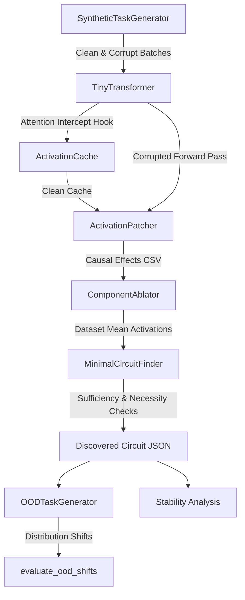

# Architecture Overview

This document describes the codebase architecture, module responsibilities, tensor dataflows, and hook mechanisms implemented in `causal-circuit-discovery`.

---

## 1. High-Level System Architecture

The repository implements a modular pipeline designed to separate synthetic dataset generation, model forward execution, activation capture, causal interventions, subnetwork search, and evaluation.



---

## 2. Core Modules & Responsibilities

| Module | Primary Class / Function | Responsibility |
| :--- | :--- | :--- |
| `src/config.py` | `ModelConfig`, `TrainConfig` | Dataclass definitions specifying architecture hyperparameters ($L=4, H=4, d_{\text{model}}=128$), seed, and training settings. Defaults safely to `device="cpu"`. |
| `src/model.py` | `TinyTransformer`, `MultiHeadAttention` | 4-layer decoder-only causal Transformer implemented from PyTorch primitives with forward hooks injected before $W_O$. |
| `src/dataset.py` | `SyntheticTaskGenerator`, `AssociativeRecallDataset` | Algorithmic associative recall generator producing paired clean and corrupted sequences with ground-truth target tokens. |
| `src/activations.py` | `ActivationCache` | Non-destructive activation interceptor capturing per-head representations $(B, H, T, d_{\text{head}})$. |
| `src/patching.py` | `ActivationPatcher` | Interventional engine performing activation patching across all attention heads to compute normalized causal effects. |
| `src/ablation.py` | `ComponentAblator` | Computes dataset-wide mean activations and evaluates model performance when subsets of heads are clamped to means or zero. |
| `src/circuit_search.py` | `MinimalCircuitFinder` | Implements greedy backward pruning to identify the smallest subnetwork satisfying a retention constraint $\ge \alpha \cdot \text{Baseline}$. |
| `src/circuit_metrics.py` | `plot_causal_heatmap`, `select_candidate_components` | Visualizes activation patching heatmaps and ranks causal candidate heads. |
| `src/metrics.py` | `compile_final_tables`, `compute_bootstrap_ci` | Aggregates experimental metrics, computes bootstrap confidence intervals, and exports summary tables. |
| `src/stability.py` | `run_cross_seed_analysis` | Computes pairwise structural similarity (Jaccard) and functional correlation (Pearson $r$) across multiple random initializations. |
| `src/ood.py` | `OODTaskGenerator`, `evaluate_ood_shifts` | Generates distribution shifts (unseen entities, sequence distractors, context length scaling) and measures circuit generalization. |

---

## 3. The Hook Injection Mechanism

Activation patching and ablation require precise, non-destructive intervention at specific computational nodes. In `src/model.py`, the attention head outputs before final linear projection $W_O$ are intercepted:

```python
# From src/model.py: MultiHeadAttention.forward
head_out = attn_pattern @ v  # Shape: (B, n_heads, T, d_head)

if hook_fn is not None and layer_idx is not None:
    head_out = hook_fn(head_out, layer_idx)

out = head_out.transpose(1, 2).contiguous().view(B, T, C)
return self.W_o(out)
```

### Intervention Modes:
1. **Caching (`ActivationCache`):** Caches $a_{l, h}$ into a detached PyTorch dictionary without altering downstream forward values.
2. **Patching (`ActivationPatcher`):** Clones `head_out` and substitutes slice `[:, target_head, :, :]` with the cached clean activation.
3. **Mean Ablation (`ComponentAblator`):** Substitutes ablated head slices with dataset mean tensor $\bar{a}_h \in \mathbb{R}^{1 \times 1 \times 1 \times d_{\text{head}}}$, which automatically broadcasts across arbitrary batch sizes and sequence lengths.
